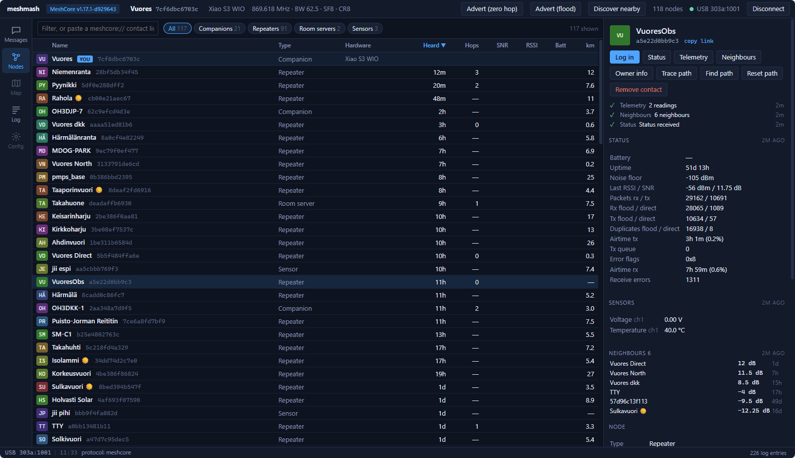
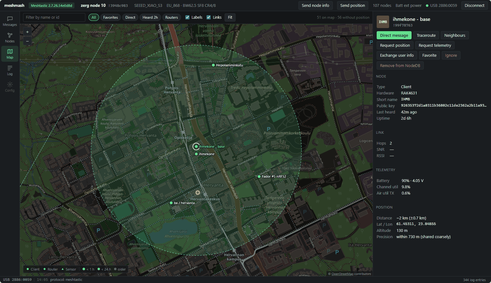
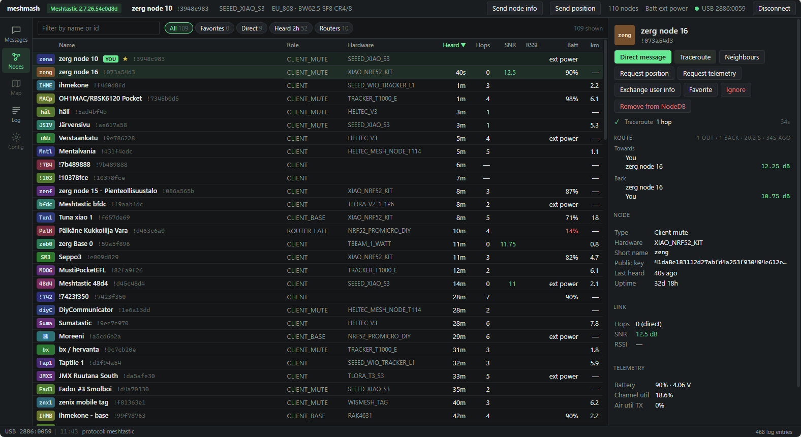
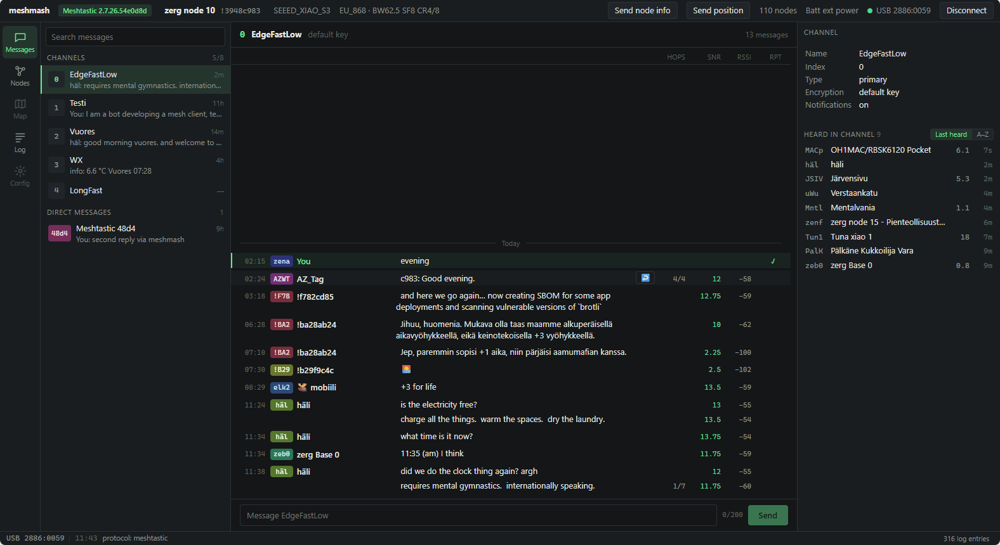
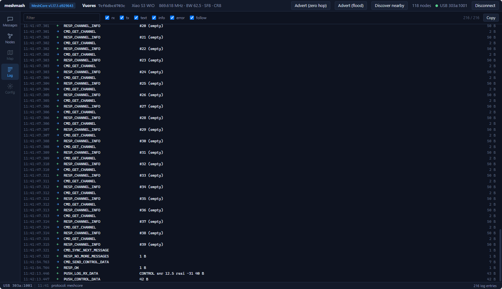
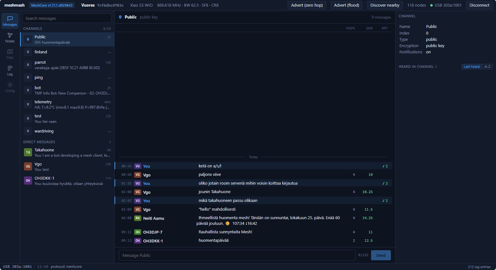
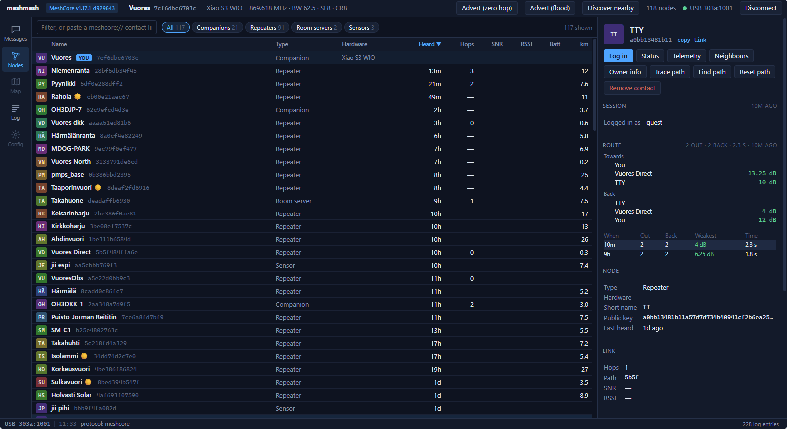
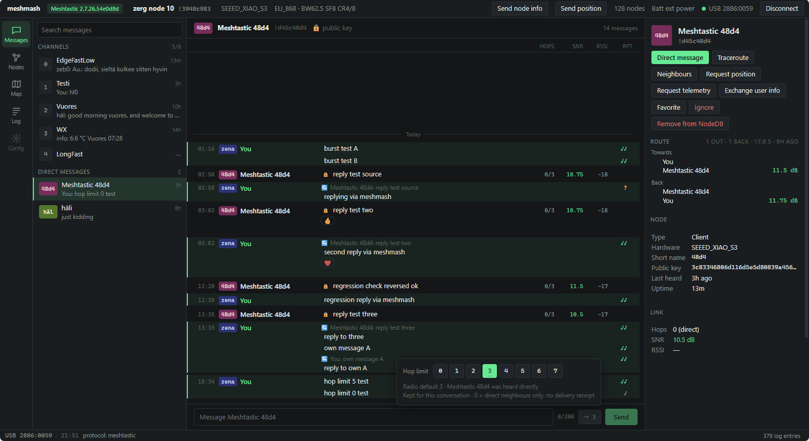
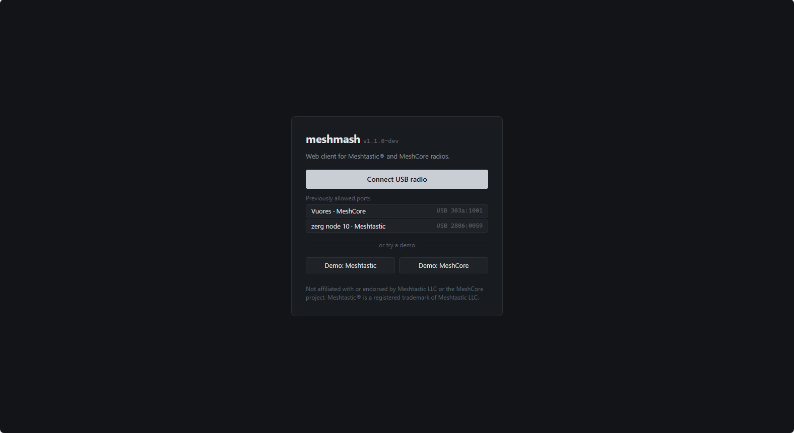

# meshmash

Browser client for Meshtastic® and MeshCore LoRa mesh radios.

Plug a radio in over USB, open the page, and meshmash detects whether it runs Meshtastic or
MeshCore and adapts the interface to it. No install, no account, no server: the page talks to
the radio directly over Web Serial, and everything it keeps stays in the browser.



## Features

**Both protocols**
- Protocol and firmware detection; the interface follows the radio's capabilities
- Channels and direct messages with delivery state, search, unread markers and per-thread byte limits
- Node list with filters, signal, hops, battery and distance; node details with telemetry history charts
- Map: OpenStreetMap tiles, node markers by type and last heard, direct links, traceroute and neighbour links of the selected node
- Distances from coarse positions marked `~`; selected node's position uncertainty drawn on the map
- Reconnects automatically after a USB drop or page reload
- Raw protocol log
- Message history and node data stored per radio in IndexedDB

**Meshtastic**
- Traceroute with SNR per hop and history
- Position, telemetry, user info and neighbour info requests
- Replies and emoji reactions
- Hop limit per message: kept per DM, one-off on channels; suggested when the other node was heard further away
- PKI-encrypted direct messages marked 🔒, with readable PKI error messages
- Position precision (`precision_bits`), also inferred for NodeDB positions that lack it
- Favourite, ignore, remove from NodeDB

**MeshCore**
- Repeater and room server login; status, telemetry (CayenneLPP), neighbours, owner info
- Remote CLI console for administered nodes
- Trace path and path discovery, with "use this path"
- Room server posts with authors
- Discover nearby nodes (both-way SNR)
- Contact links (`meshcore://contact/add`), auto-add settings, adding heard-but-unsaved nodes
- Share contact (zero-hop re-send of a stored advert) for all contact types
- Radio clock set on connect

## Screenshots

| | |
|---|---|
|  Map, coarse position selected |  Meshtastic nodes by distance, `~` = coarse |
|  Meshtastic channel |  Protocol log |
|  MeshCore channel |  MeshCore two-hop trace and history |
|  Hop limit per message |  Connect screen |

## Requirements

- A Chromium-based desktop browser (Chrome, Edge, Opera): Web Serial is not available in Firefox or Safari
- A Meshtastic or MeshCore (companion USB firmware) radio connected by USB
- Demo modes for both protocols work without a radio

Bluetooth and radio configuration are not implemented yet.

## Development

```sh
npm install
npm run dev     # http://localhost:5173
npm run check   # type check
npm test        # unit tests
npm run build   # static build in dist/
```

The protocol codecs are written from the firmware sources; no Meshtastic or MeshCore JavaScript
libraries are used. Protocol notes are in [docs/](docs).

## License

GPL-3.0-only. See [LICENSE](LICENSE).

Not affiliated with or endorsed by Meshtastic LLC or the MeshCore project.
Meshtastic® is a registered trademark of Meshtastic LLC.
